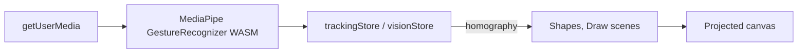

<p align="center">
  <picture>
    <source media="(prefers-color-scheme: dark)" srcset="assets/brand/logo-dark.svg">
    
  </picture>
</p>

<p align="center"><b>Turn any wall into a touchless display with a webcam, a projector and a browser tab.</b></p>

Dixi tracks your hands in the browser (MediaPipe WASM), maps the camera view onto the projected image with a
four-point calibration, and lets you pinch to grab and draw on what is projected. Logo is a proposal pending owner sign-off.

> TODO: add a screenshot or short recording from a real rig. Launcher preview: [`docs/design-shots/launcher-after.png`](docs/design-shots/launcher-after.png).

## Quick start

Requires Node 20+, a webcam, and (optionally) a projector. The camera needs `localhost` or HTTPS.

```bash
git clone https://github.com/duketopceo/Dixi.git && cd Dixi
npm ci
npm run dev:frontend        # http://localhost:3000
```

1. Allow the camera. The Launcher shows two scenes: **Shapes** (pinch to grab, two hands to scale) and **Draw** (pinch = pen, fist = clear).
2. Choose "Calibrate camera <-> projector" and dwell a fingertip on each of the four projected corners. Calibration is saved in `localStorage`.
3. No projector? It works on your screen with mirrored pointing; skip calibration.

## How it works



- `packages/frontend/src/vision/`: tracker client, 4-point homography (`homography.ts`), gesture rules, camera lifecycle.
- `packages/frontend/src/components/` and `scenes/`: Launcher, Dock, calibration overlay, scenes.
- Legacy "server mode" (`VITE_VISION_MODE=server`): a Node/Express + WebSocket backend (`packages/backend`, port 3001, Ollama AI routes) and a Python vision service (`packages/vision`). Not needed for the scenes above; its future is roadmap unit U2.

## Checks

```bash
npm run build:check -w packages/frontend && npx vitest run --root packages/frontend
npm run build -w packages/backend && npm test -w packages/backend
```

`npm run lint` currently fails because no ESLint config exists (roadmap U1).

## Status and roadmap

Browser vision mode and the scene shell are done; see [ROADMAP.md](ROADMAP.md) (program plan first) and
[docs/research/2026-10-10-landscape.md](docs/research/2026-10-10-landscape.md). Design direction: [DESIGN.md](DESIGN.md).
Older server-era guides remain in `docs/` and `QUICK_START.md` and may be out of date.

## Contributing

See [CONTRIBUTING.md](CONTRIBUTING.md) and [AGENTS.md](AGENTS.md). CONTRIBUTING.md names a `development` branch; this program PR targets `main`.

## License

MIT, see [LICENSE](LICENSE).
